# Velia

## 1. Descripción breve
Velia es una aplicación móvil de cuidado digital para adultos mayores que viven en asilos o con su familia. Permite llevar el horario de medicamentos, un calendario de citas y aniversarios, un botón verde "Estoy bien" para avisar a la familia y un botón rojo de emergencia. Está hecha con Flutter y Dart.

## 2. Los 3 tipos de usuario y sus dashboards

| Tipo de usuario | Qué ve en su dashboard | Usuario de prueba |
|---|---|---|
| **Administrador** | Totales de usuarios, eventos y medicamentos, y la lista de usuarios registrados. | `admin@velia.com` / `Admin123` |
| **Cliente (adulto mayor)** | 3 pestañas: Horario, Chequeo (botón "Estoy bien") y Calendario, más el botón de emergencia. | `carmen@velia.com` / `Carmen123` |
| **Familiar** | 3 pestañas: Resumen (último aviso, próxima pastilla, historial), Horario y Calendario. | `laura@velia.com` / `Laura123` |

La navegación entre dashboards se hace desde el **menú lateral** (ícono de las tres rayitas), que también tiene la opción de cerrar sesión.

## 3. Manejo de estado elegido (y por qué)
Se eligió **Provider** con un `ChangeNotifier` llamado `EstadoApp`.
- **Un solo lugar para todo:** el usuario, el rol activo, la lista de medicamentos, la lista de eventos y los avisos "Estoy bien" viven en `EstadoApp`.
- **Persiste al navegar:** el estado se crea una sola vez en la raíz de la app (`main.dart`), por eso no se pierde al cambiar de pantalla o de panel.
- **Las pantallas se actualizan solas:** con `context.watch` se redibujan cuando algo cambia y con `context.read` se ejecutan acciones (agregar, eliminar, iniciar sesión).

> Los datos viven en memoria: se conservan al navegar, pero se reinician al cerrar la app por completo.

## 4. Cómo ejecutar la app
1. Instalar Flutter y tener un emulador o un celular conectado.
2. Crear un proyecto: `flutter create velia`
3. Reemplazar la carpeta `lib` y el archivo `pubspec.yaml` por los de este repositorio.
4. Instalar dependencias: `flutter pub get`
5. Ejecutar: `flutter run`

Estructura de `lib/`:
- `main.dart`: inicio de la app y Provider.
- `estado/estado_app.dart`: todo el estado.
- `modelos/`: `Usuario`, `Medicamento` y `Evento`.
- `datos/datos_ejemplo.dart`: datos con los que arranca la app.
- `pantallas/`: una pantalla por archivo (splash, login, registro, 3 paneles, horario, chequeo, calendario, formularios y detalle).
- `widgets/`: botón de emergencia, menú lateral y estado vacío.
- `utilidades/`: validadores, formatos de fecha y navegación.
- `tema/colores.dart`: colores de la app.

## 6. Screenshots

### Splashscreen
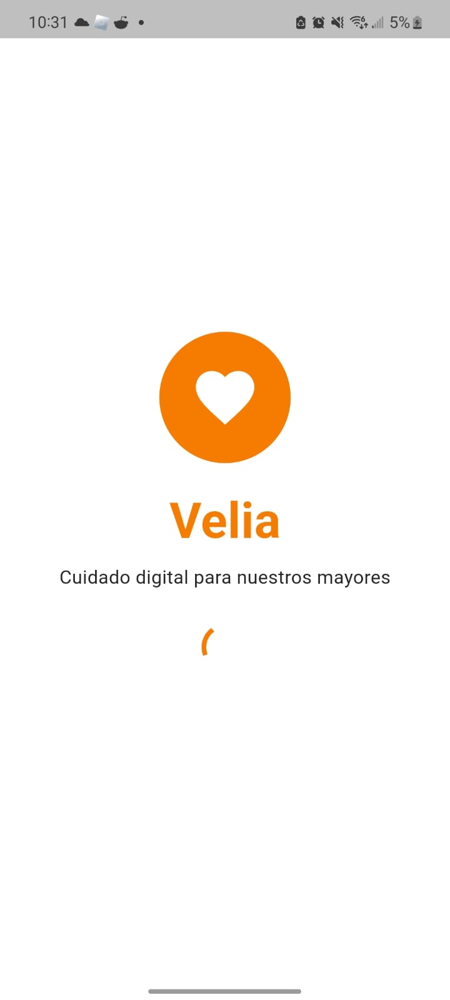

### Autenticación
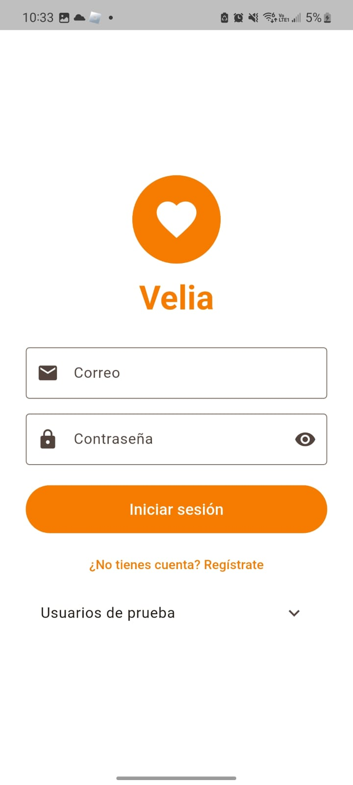
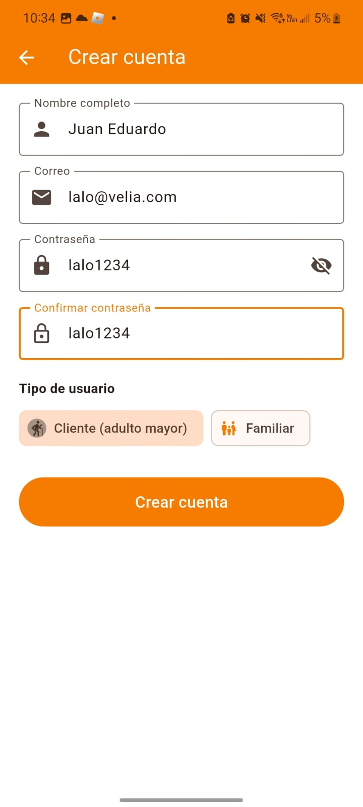

### Dashboards
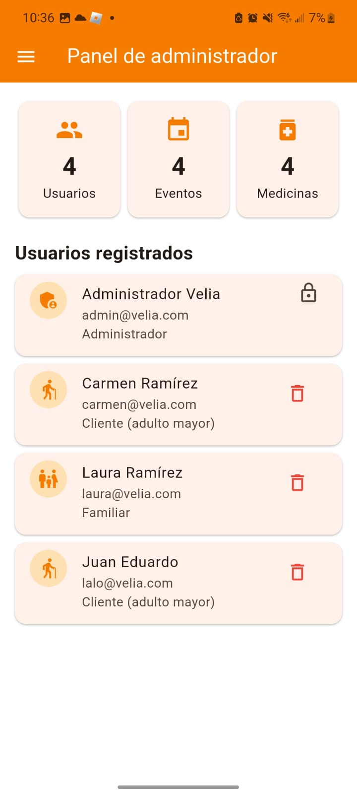
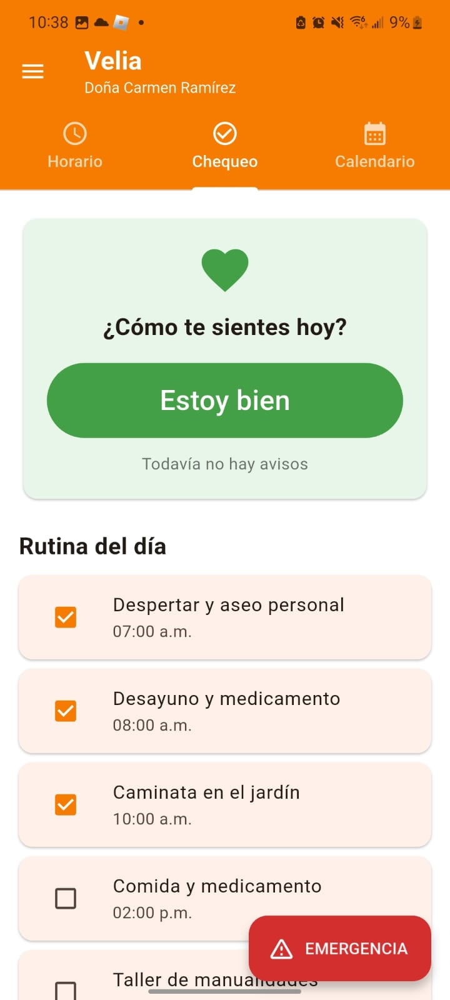
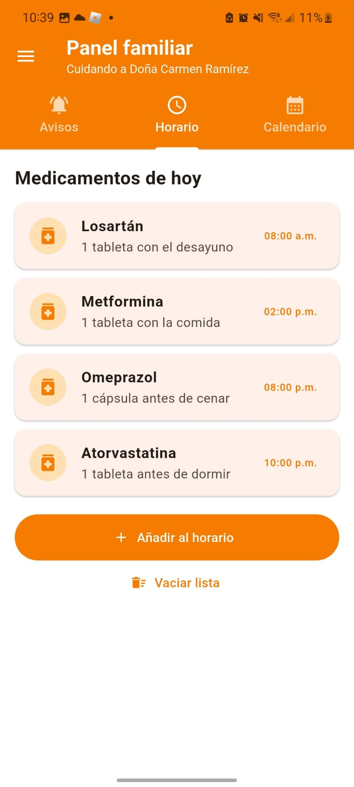

### Listas
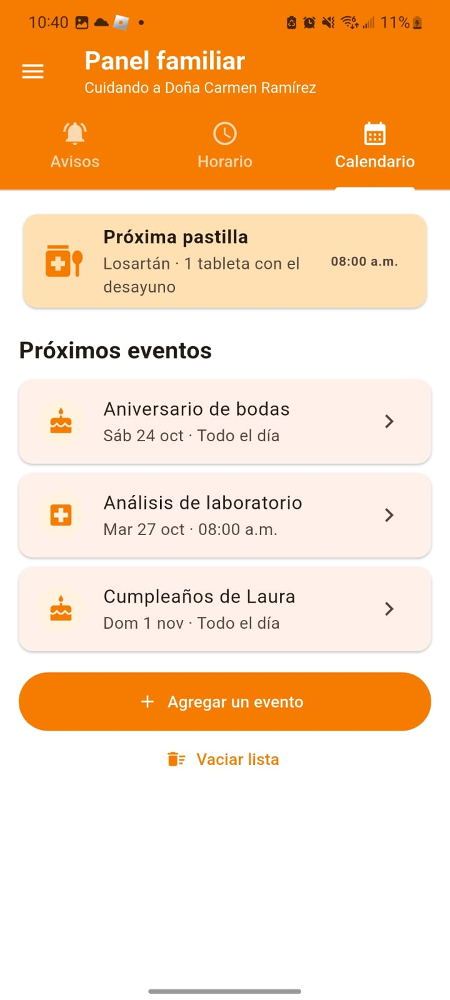
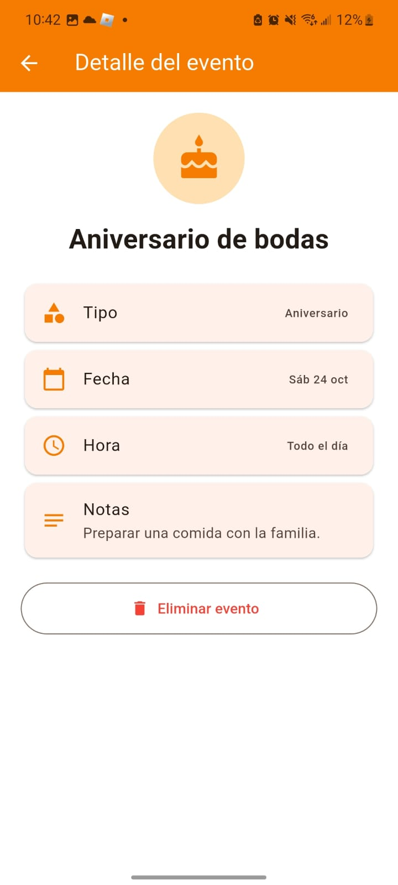
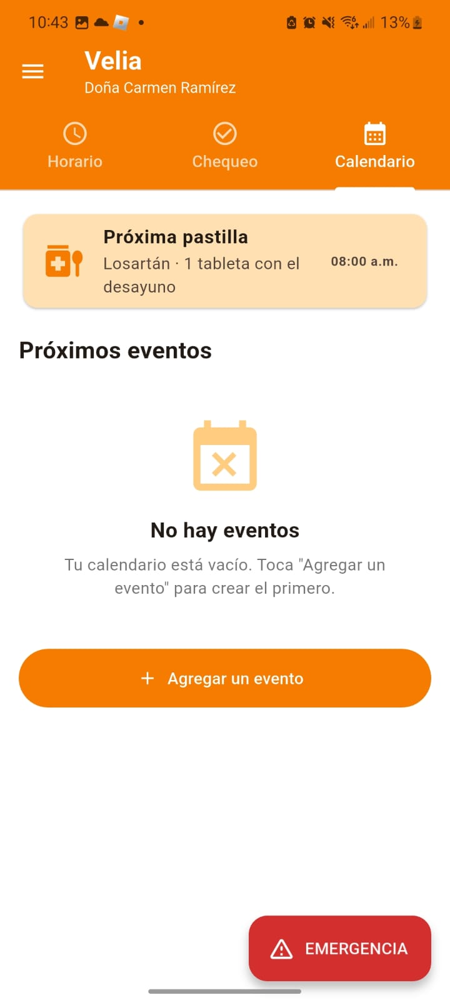

### Formularios
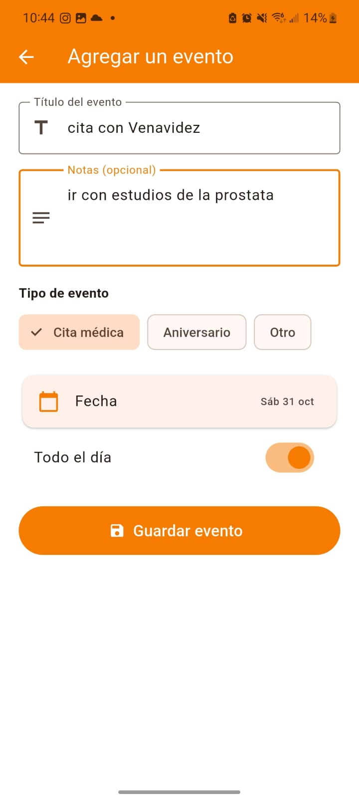
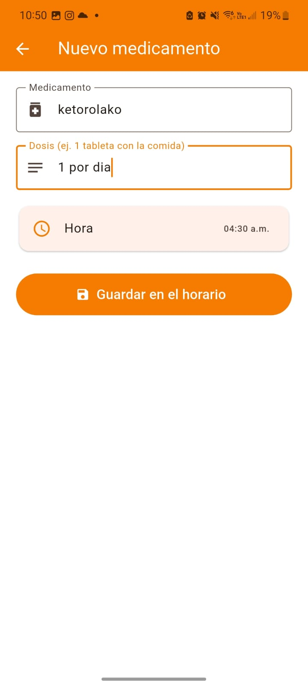

### Evidencia funcional
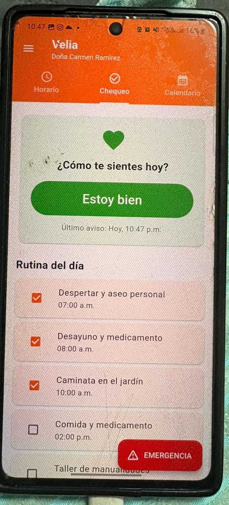
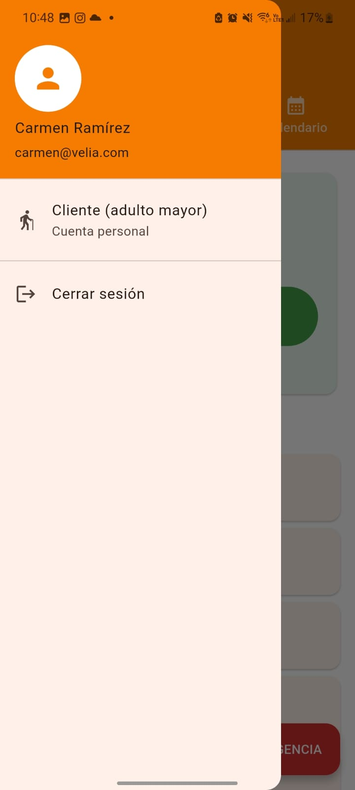
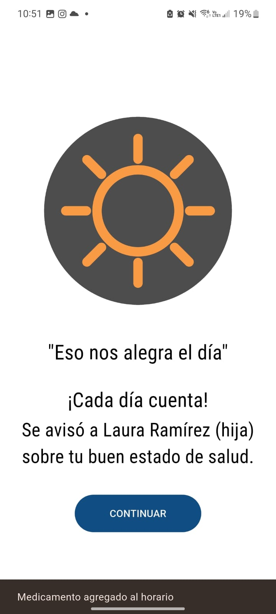
